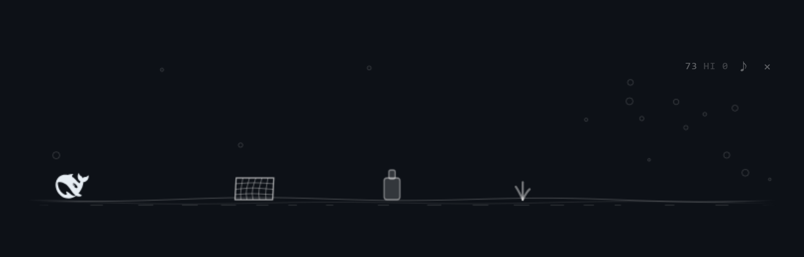
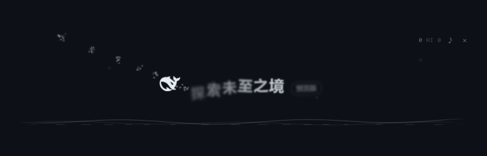
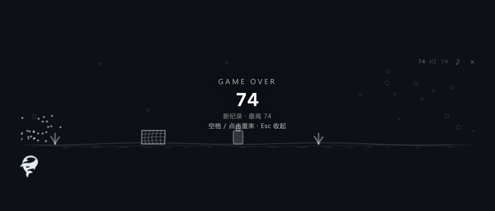

# dsh-whale-run

**A hidden mini-game plugin for DeepSeek Harness (dsh) desktop.** Grab the whale off the UI, drop it on a runway that slides out above the composer, and run a round — a Chrome-dino style runner with ocean-themed obstacles.

给 **DeepSeek Harness 桌面版**的隐藏小游戏：**把界面上那只鲸鱼摘下来，放到输入框上方的跑道上，跑一局。**

> 这是一个 **dsh 客户端插件**，不是一个独立程序。它靠 `cordis.patch.yml` 挂进 dsh 的插件 loader 树（`dsh.bundle.patch` + `dsh.client.platform="web"`，三缺一会静默不加载），用 `install.cmd` 装进 `profiles/<名字>/node_modules/`。
>
> **先得有 dsh 本身**：桌面版在官网下 —— [deepseek.com/download](https://www.deepseek.com/download/)（现在是预览版，Windows x64 和 Apple 芯片 macOS 各一个安装包）。装好打开、新建一个空会话，就能看到欢迎页那只鲸鱼。

学的是 GitHub Copilot 桌面版拖 Octocat 头的玩法，玩法本身是小恐龙（Chrome 断网那只）。



## 怎么玩

1. 新建一个会话 —— 欢迎页标题「探索未至之境」**左边**那只鲸鱼（侧边栏左上角那只也行）**按住就能拿起来**。
2. 拿起来的一瞬间，那句标题会**碎成一片波浪**飘走，同时输入框上方缓缓涌出一条很淡的水面。

   

3. 把鲸鱼拖到水面上**松手**：它会从落点慢慢游到跑道开头，然后开跑（落在中间也不会瞬移归位）。
4. 跑起来之后：

   | 操作 | 效果 |
   |---|---|
   | `空格` / `↑` / `W` | 起跳（**按住可以跳更高**，松手就收） |
   | `↓` / `S` | 下潜，躲头顶的水母 |
   | `空格` / 点一下跑道 | game over 后重开 |
   | `Esc` / 右上角 `×` | 收起跑道，鲸鱼飞回原位 |
   | 右上角 `♪` | 音效开关（会记住） |

5. 障碍物全是海洋梗：**塑料瓶 / 渔网 / 珊瑚**要跳过去，**水母**要么下潜要么硬跳（看它漂多高）。
6. 每 100 分闪一下，每 700 分从「透光浅海」切到「幽暗深海」。最高分存在本机。
7. **跟着 dsh 的主题走** —— 浅色主题下线稿、水面和文字整体转成黑色，切一下主题立刻就变，不用重开。

**没放进水面就松手** = 鲸鱼直接往下掉，碰到窗口下边框化成一圈水花消失，然后**变回原来那只图标**（有一下淡入）。

撞死也一样，只是它先**被打飞**出去、翻着跟头掉出窗口下沿，水面退去之后图标和那句标题才一起回来：



跑道上那只鲸鱼跟原位那只**一样大**（原样有多大就画多大），拖起来不会突然胀一圈。

## 装 / 卸

两种拿法：`git clone` 这个仓库，或者到 [Releases](https://github.com/wei125775-lab/dsh-whale-run/releases/latest) 下 `dsh-whale-run-*.zip` 解压。

安装器是个 Node 脚本（包本身零依赖）。机器上有 Node 就直接用；**没装也不要紧** —— `install.cmd` 会自动去借 **dsh 自带的那个 Node**（桌面版内置了），两边都找不到时它才会提示你。
macOS / Linux 上没有 `.cmd`，在解压出来的目录里直接跑 `node install.mjs` 就行（参数跟 Windows 下一样）。

```cmd
install.cmd                  :: 装（双击也行）
install.cmd --dry-run        :: 只打印要改什么
install.cmd --verify         :: 装完自检
install.cmd --uninstall      :: 卸
```

也可以直接跑 `node install.mjs [--dsh-home 路径] [--profile 名字]`。

脚本只干三件事：把文件复制进 `<profile>/node_modules/@dph/dsh-whale-run`、在 profile 的 `package.json` 里登记 `dependencies` 和 `dsh.profile.bundles`、留一份 `package.json.bak-whalerun` 备份。
**不碰 pnpm、不碰 npm registry** —— 这个包零依赖、纯本地。

> **首次安装必须完全退出并重开 app**（profile 的 patch 只在启动时读一次）。
> 之后改 `lib/client.js`，HMR 会让它存盘约 1 秒自动生效，**不用重启**。

## 开发

```cmd
:: 另开：把鲸鱼 logo 的 path 从 app.asar 抠进 fixture（换了 dsh 版本再跑一次）
node test/extract-fish.mjs

:: 离线跑断言 + 出图，几秒一轮、零风险，不用起 dsh
node test/cdp-harness.mjs

:: 重截 README 里那三张放大特写（跑道的 clip + 2.5 倍）
node test/shoot-shots.mjs
```

`test/harness.html` 是一套假 dsh：假的 `data-slot` 鲸鱼、假的 `data-composer-*` 输入框、假的 `__ModuleLoader__`、假的 `ctx`，还暴露了 `window.__whaleRun`（`grab / moveTo / release / dropNow / key / setSeed / engine`）给脚本驱动。截图落在 `test/shots/`。

`setSeed(n)` 之后重开一局，障碍序列完全可复现 —— 像素级回归靠它。

真机联调：带 `--remote-debugging-port=9222` 重启 app，然后跑 `test/cdp-live.mjs`。

## 它是怎么接进去的

| 位置 | 说明 |
|---|---|
| `lib/client.js` | 全部逻辑（浏览器半侧）。**单文件，但按 `§1 config` ~ `§11 apply` 分了区**，引擎和美术是零 DOM 副作用的纯函数，将来可以直接搬进 `lib/client.engine.js`（`require.async` + `chunk:` 拆包机制是现成的） |
| `lib/index.js` | 宿主半侧空壳。存在的意义只是让本包出现在 loader 树里 —— 客户端半侧只挂在「说明符恰好等于包名」的那条 entry 上 |
| `cordis.patch.yml` | 那条 entry 就是它 insert 出来的 |
| `package.json` | `dsh.bundle.patch` + `dsh.client.platform="web"` + `exports["./client"]`，三缺一都会**静默不加载** |

**用的锚点全是非 hash 的**：`[data-slot="conversation.hero.brand.mark"]`、`[data-slot="sidebar.brand.mark"]`、`[data-composer-card]`、`[data-composer-input]`。绝不写死 `Hqq-bq_*` / `RlGAzG_*` 这种 CSS module 类名。

**鲸鱼的形状是当场从 DOM 上读的**（`svg > path` 的 `d` + `viewBox`，颜色读 `getComputedStyle(svg).color`），所以升级 dsh 换 logo 之后画的还是新的那只，不会过期。找不到鲸鱼就整个不动手，不硬塞一份写死的 path。

**主题同理，不写死颜色**。dsh 的两套 token 都挂在 `<body>` 上（浅色是 `body{}` 那一块，深色是 `body[data-ds-dark-theme]{}` 那一块），所以先看这条属性、再看 `--dsw-alias-label-primary` 的亮度，判出当前是浅色还是深色；不拿 `prefers-color-scheme` 当主判据，因为 dsh 允许手选主题。判完就把墨色整体翻一档：CSS 那半边是靠 `#whale-run-root` 上的通道变量，canvas 那半边每帧现读。切主题时渲染循环和环境监听都会跟上。

## 已知限制

- **只在有鲸鱼的界面上能抓**。会话里有消息之后 hero 鲸鱼就没了 —— 侧边栏那只还在，所以还能玩。
- **macOS 没验证过**。侧边栏那只的祖先带 `data-window-drag`，那个窗口拖动区的 CSS **只在 darwin 生效**；Windows 上完全无副作用，macOS 上需要在按下时临时给祖先链写 `-webkit-app-region: no-drag`（代码里有这条分支，但没实机试过）。
- **退出游戏后如果输入框光标不见了**，点一下输入框就行 —— 焦点还给 Lexical 是它自己的事，我们只调 `focus()`，不自己造 Range。
- 音效默认**开**，觉得吵点 `♪` 关掉，会记住。
- 平台弹层（命令面板、设置、"⋯"菜单）出现时游戏会自动让位，不会挡在上面。
